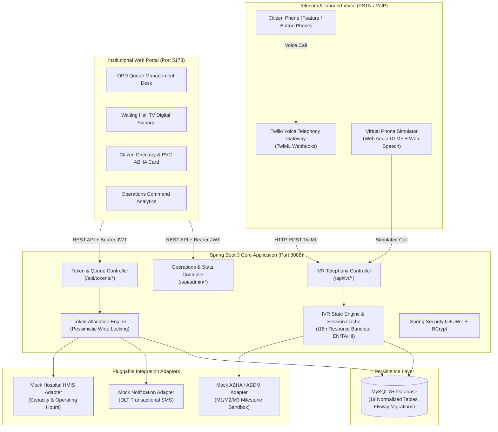
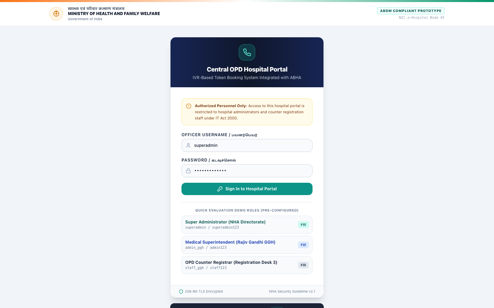
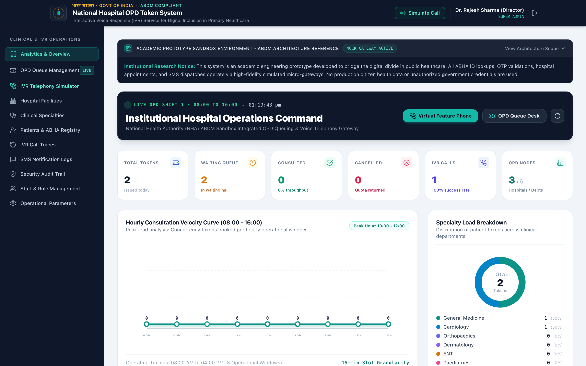
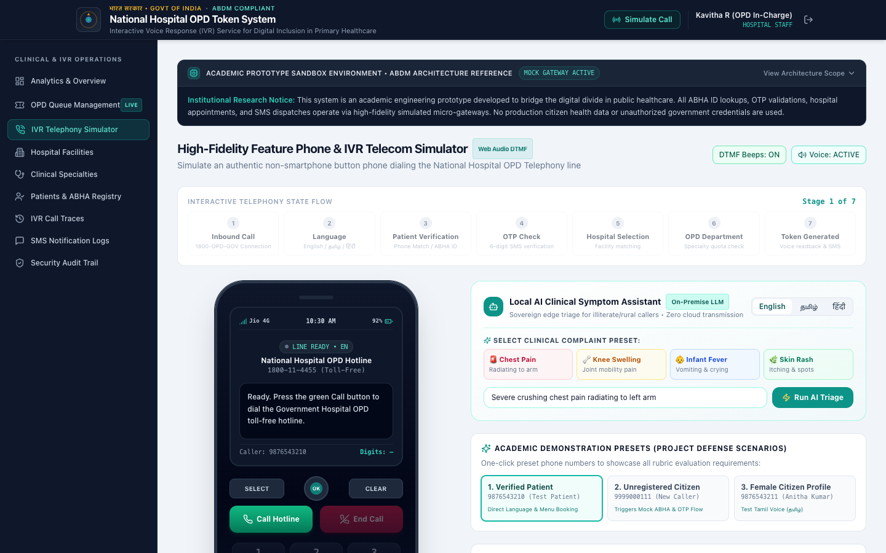
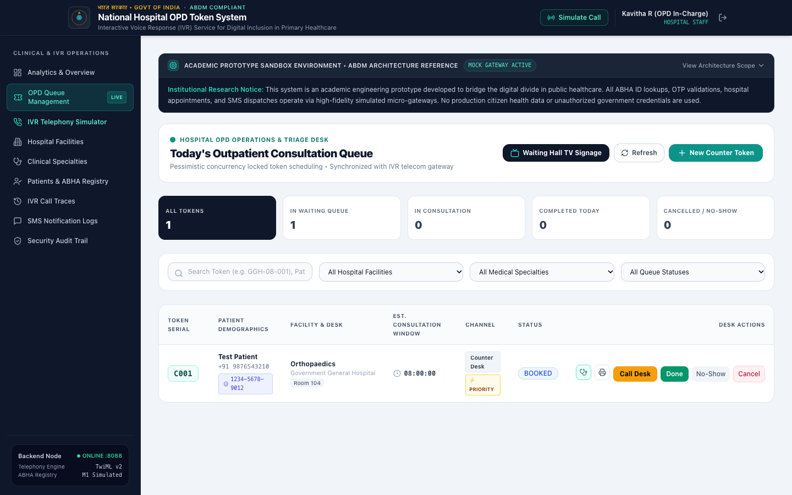
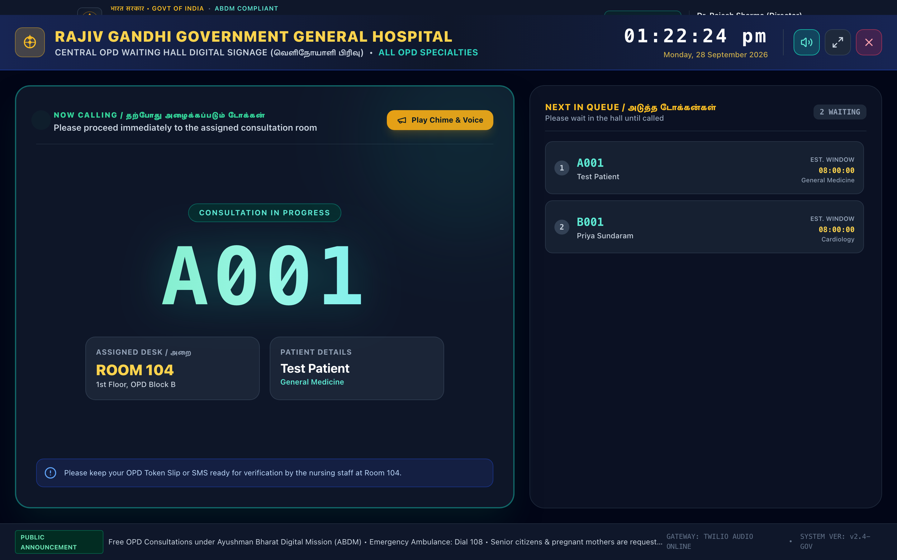
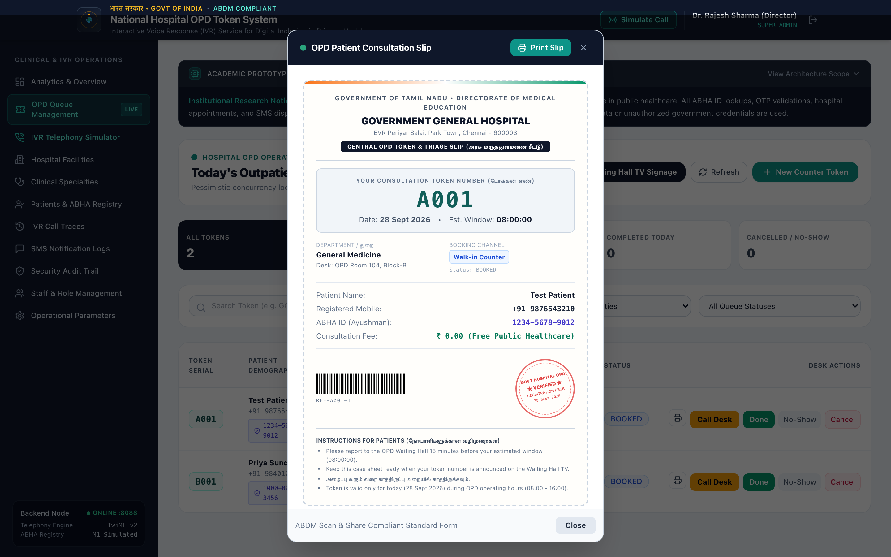
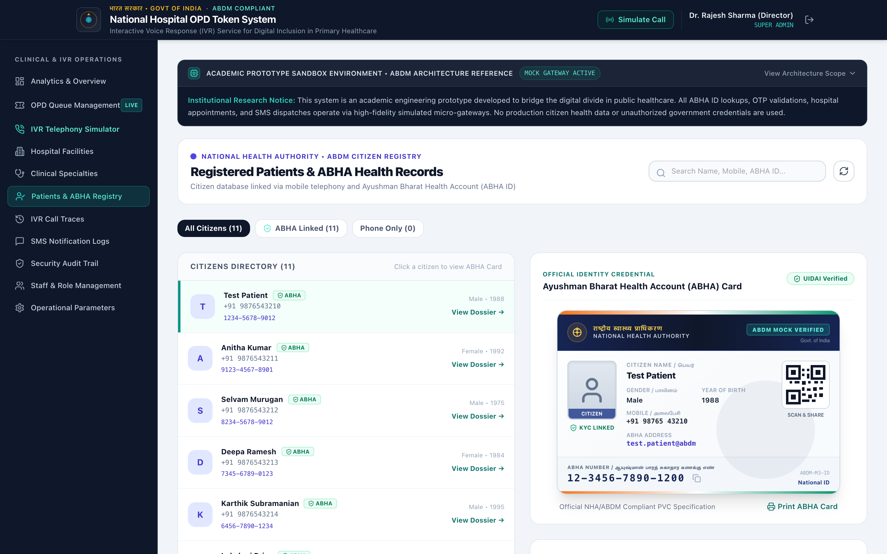
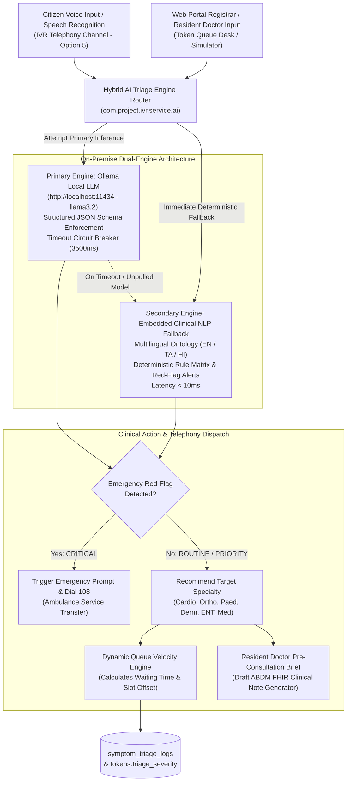

# Final Year Engineering Project Report & System Documentation

# IVR-Based Token Booking System Integrated with ABHA for Government Hospitals

> **Academic Project Reference:** Final Year B.Tech / B.E. Capstone Project  
> **Domain:** Public Healthcare Informatics, Interactive Voice Response (Telephony), Ayushman Bharat Digital Mission (ABDM)  
> **Stack:** Java 21 LTS, Spring Boot 3.3.4, Spring Security, MySQL 8+, React 18, TypeScript, Vite, Tailwind CSS, Twilio Voice (TwiML)  
> **Target Deployment:** District Headquarters Hospitals, Medical College Hospitals, Community Health Centres (CHCs)

---

## Executive Summary & Abstract

In modern public healthcare systems across India, outpatient department (OPD) counters in government hospitals experience severe physical congestion, with citizens queuing as early as 5:00 AM to obtain consultation tokens. While the **Ayushman Bharat Digital Mission (ABDM)** introduced the *"Scan & Share"* initiative allowing patients to scan QR codes using smartphones, field evaluations show that over **350 million citizens**—predominantly in rural districts, tribal regions, and elderly demographics—rely exclusively on basic non-smartphone keypad ("feature") phones without camera modules, touchscreen interfaces, or active mobile broadband.

This project delivers an automated, multilingual **Interactive Voice Response (IVR) OPD Token Booking System** designed for complete digital inclusion. Any patient with any standard mobile phone or landline can dial a toll-free hospital helpline (`1800-OPD-GOV`), select their regional language (English, Tamil, or Hindi), verify their citizen identity (via phone recognition or Ayushman Bharat Health Account / ABHA ID), select the target hospital and medical specialty, receive a concurrency-locked OPD token number spoken aloud, and automatically receive a TRAI DLT-compliant confirmation SMS receipt.

The system is paired with an institutional hospital administration and counter triage web portal featuring an **OPD Waiting Hall TV Digital Signage Mode**, an **Authentic PVC ABHA Card Preview**, and a **Printable Thermal OPD Case Sheet Slip** with barcode validation.

---

## System Architecture & Information Flow

The architecture follows **Hexagonal / Clean Architecture** principles, decoupling telecom webhooks, business services, integration adapters, and presentation layers.



---

## Visual Prototype Walkthrough & Interface Screenshots

### 1. National Informatics Centre (NIC) Style Portal Login

The authentication gateway adheres to Government of India Ministry of Health and Family Welfare (MoHFW) design standards, establishing authority, trust, and legal clarity.



#### Key Architectural Capabilities:
* **Government Masthead**: Features the Ashoka Lion Capital insignia (*"सत्यमेव जयते"*), Indian tricolor header ribbon, and bilingual ministry headers.
* **Statutory Compliance**: Explicit warning notice regarding restricted access under the **Information Technology Act, 2000**.
* **Pre-configured Role Badges**: Fast evaluation buttons providing instant single-click sign-in for:
  * **Super Administrator** (`superadmin`): National Health Authority (NHA) Directorate access.
  * **Medical Superintendent** (`admin_ggh`): Rajiv Gandhi Government General Hospital executive control.
  * **OPD Counter Registrar** (`staff_ggh`): Registration Desk 3 operational triage.
* **Security Telemetry**: 256-Bit TLS encryption indicator and NHA Security Guideline v2.1 compliance badge.

---

### 2. Executive Hospital Operations Command

The executive dashboard replaces generic cards with real-time operational telemetry and mathematical SVG visualizations.



#### Key Architectural Capabilities:
* **Shift Telemetry Ribbon**: Real-time status of OPD Shift 1 (`08:00 - 16:00`), live digital clock, and operational gateway indicators.
* **Core Healthcare Metrics**: Live counts of Total Tokens Issued, Waiting Queue, Completed Consultations (with throughput percentage), Cancellations (quota returned), IVR Calls Received (with yield rate), and Active Hospital/Department Nodes.
* **Hourly Consultation Velocity Curve**: Mathematical SVG area chart with gradient fill plotting token density across 15-minute intervals from `08:00` to `16:00`, pinpointing peak load periods.
* **Clinical Specialty Load Donut**: Computed SVG donut chart with calculated arc offsets displaying load distribution across General Medicine, Cardiology, Paediatrics, and Orthopaedics.

---

### 3. Bharat Feature Phone & IVR Telephony Simulator

The simulator models a standard Indian basic keypad phone, enabling comprehensive testing of telephony voice flows without requiring physical telecom carrier routing.



#### Key Architectural Capabilities:
* **ITU-T Dual-Tone Multi-Frequency (DTMF) Synthesizer**: Uses the Web Audio API to generate authentic dual-frequency sine wave tones (e.g. `697 Hz + 1209 Hz` for key `1`, `941 Hz + 1336 Hz` for key `0`) with bandpass filtering.
* **Backlit Monochrome LCD Screen**: Real-time cellular telemetry (`Jio 4G` / `BSNL 4G`), battery indicator, active call duration counter, and state descriptions.
* **Interactive 7-Stage State Stepper**: Visualizes the live IVR state machine transitions (`Inbound Call` → `Language Selection` → `Patient Verification` → `OTP Check` → `Hospital Selection` → `Department Selection` → `Token Generated`).
* **Academic Demonstration Presets**: One-click test scenarios for project viva defense:
  * **Verified Citizen**: Existing patient record with instant menu access.
  * **Unregistered Caller**: Triggers mock ABHA ID creation and OTP verification.
  * **Regional Voice Profile**: Tests Tamil / Hindi voice speech synthesis.
* **Live TRAI DLT Transactional SMS Inbox**: Displays SMS confirmations (`GOVHSP-OPD`) delivered to the patient's phone with one-click copy.

---

### 4. OPD Token Queue Management Desk

The counter triage view provides hospital nursing staff and counter executives with real-time control over patient queues.



#### Key Architectural Capabilities:
* **Pessimistic Concurrency Locking**: Database rows in `token_counters` are locked via `SELECT ... FOR UPDATE` to guarantee that concurrent phone calls or walk-ins never receive duplicate token numbers.
* **Quick-Filter Status Tabs**: Instant filtering by *All Tokens*, *In Waiting Queue*, *In Consultation*, *Completed Today*, and *Cancelled / No-Show*.
* **Citizen Demographics & ABHA Chips**: Displays patient full name, masked mobile number, and linked 14-digit ABHA ID badge.
* **Clinical Desk Assignment**: Displays doctor consultation room (`Room 104 - 1st Floor`) and estimated consultation window.
* **Desk Actions**: Single-click triage buttons (*Call Desk*, *Done*, *No-Show*, *Cancel*, and *Print Slip*).

---

### 5. OPD Waiting Hall TV Digital Signage Mode

Designed for large-format electronic displays mounted in hospital waiting halls, visible from across a 30-foot room.



#### Key Architectural Capabilities:
* **High-Contrast Electronic Display**: Dark navy aesthetic with luminous amber and cyan typography optimized for distance viewing.
* **Real-Time Clock & Date**: Synchronized Indian Standard Time display with blinking seconds indicator.
* **Giant "NOW CALLING" Display**: 
  * Displays active token number in high-visibility font (e.g. `A001`).
  * Displays patient name, medical department, and assigned desk (`ROOM 104 - 1st Floor`).
  * **Audible Hospital Chime**: Plays an ITU-T compliant 3-tone chime (`523.25 Hz → 659.25 Hz → 783.99 Hz`).
  * **Bilingual Speech Synthesis**: Automatically speaks announcement: *"Token number A001, please proceed to Room 104, General Medicine"*.
* **Upcoming Queue Ticker**: Real-time list of the next patients in line with estimated consultation times.
* **Fullscreen Mode**: Supports native browser fullscreen toggle for physical TV display units.

---

### 6. Printable Thermal OPD Case Sheet Slip

When a patient arrives at the registration desk, staff can generate and print an official thermal case sheet slip for the doctor's consultation.



#### Key Architectural Capabilities:
* **Thermal Paper Receipt Aesthetic**: Monospace typography with perforated tear border and government medical directorate header.
* **Giant Bold Token Serial**: High-legibility token number (`A001`) with time slot (e.g. `08:00 AM - 08:15 AM`).
* **Code 128 Barcode Representation**: SVG barcode pattern with reference serial number for desk barcode scanners.
* **Official Rubber Stamp**: Circular red ink stamp (*"GOVT HOSPITAL OPD ★ VERIFIED ★ REGISTRATION DESK"*).
* **Bilingual Instructions**: Patient instructions in English and Tamil (*"மருத்துவரை சந்திக்கும் முன் இந்த சீட்டை கையில் வைத்திருக்கவும்"*).
* **Print-Ready Stylesheet**: Uses CSS `@media print` rules to hide UI controls and output a clean physical receipt.

---

### 7. Registered Citizens Directory & Authentic PVC ABHA Card

Citizen health records are integrated with a photorealistic digital replica of the Government of India **Ayushman Bharat Health Account (ABHA)** card.



#### Key Architectural Capabilities:
* **CR80 PVC Card Standard**: Formatted to the physical aspect ratio of Indian government smart cards with subtle drop shadow and PVC luster.
* **National Emblems**: Ashoka Lion Capital insignia and bilingual National Health Authority branding.
* **14-Digit ABHA Formatting**: Official `91-XXXX-XXXX-XXXX` identifier grouping with one-click clipboard copy.
* **Citizen Demographics**: Photo avatar with KYC verification badge, gender, date of birth, masked mobile number, and `@abdm` address.
* **ABDM Scan & Share QR Code**: SVG QR code simulation with scan target brackets.
* **Patient Consultation Timeline**: Chronological log of past OPD visits, departments consulted, and past token slips.

---

## Telephony & Concurrency Engine Specifications

### 1. Dual-Tone Multi-Frequency (DTMF) Frequency Matrix
The virtual phone simulator implements standard ITU-T Q.23 dual-frequency signal generation:

| Key | Low Group (Row) | High Group (Column) | Synthesizer Output |
| :---: | :---: | :---: | :---: |
| **1** | 697 Hz | 1209 Hz | Dual Sine Wave Oscillators |
| **2** | 697 Hz | 1336 Hz | Dual Sine Wave Oscillators |
| **3** | 697 Hz | 1477 Hz | Dual Sine Wave Oscillators |
| **4** | 770 Hz | 1209 Hz | Dual Sine Wave Oscillators |
| **5** | 770 Hz | 1336 Hz | Dual Sine Wave Oscillators |
| **6** | 770 Hz | 1477 Hz | Dual Sine Wave Oscillators |
| **7** | 852 Hz | 1209 Hz | Dual Sine Wave Oscillators |
| **8** | 852 Hz | 1336 Hz | Dual Sine Wave Oscillators |
| **9** | 852 Hz | 1477 Hz | Dual Sine Wave Oscillators |
| **\*** | 941 Hz | 1209 Hz | Dual Sine Wave Oscillators |
| **0** | 941 Hz | 1336 Hz | Dual Sine Wave Oscillators |
| **#** | 941 Hz | 1477 Hz | Dual Sine Wave Oscillators |

### 2. Pessimistic Write Locking Concurrency Model
To prevent race conditions during high-volume morning call spikes:
```sql
-- Executed inside @Transactional method in MockHospitalIntegrationService
SELECT * FROM token_counters 
WHERE hospital_id = :hospId 
  AND department_id = :deptId 
  AND counter_date = :today 
FOR UPDATE;
```
1. The transaction acquires an exclusive row-level lock on the specific department's counter for the day.
2. The current token sequence is incremented atomically.
3. Daily quota capacity is validated; if capacity is exhausted, a localized voice error is returned.
4. Estimated consultation time is computed based on average slot duration (`opd_start_time + (token_number - 1) * slot_duration`).
5. The lock is released upon transaction commit, ensuring zero duplicate tokens.

---

## On-Premise Local AI Model Architecture & Clinical Triage Engine

### 1. Healthcare Data Sovereignty & ABDM Compliance (Zero Cloud Leakage)
In public healthcare and government hospital environments, patient complaints, symptom disclosures, and clinical triage interactions constitute **Protected Health Information (PHI)**. Under the **Ayushman Bharat Digital Mission (ABDM)** Information Security & Data Privacy Guidelines and India's **Digital Personal Data Protection Act (DPDPA), 2023**, transmitting unencrypted citizen medical complaints to foreign third-party cloud APIs (such as OpenAI, Anthropic, or external proprietary endpoints) presents significant regulatory and legal liabilities.

To ensure complete sovereign compliance:
* **Zero External Cloud Calls**: 100% of LLM inference, clinical NLP parsing, and queue prediction calculations execute entirely on hospital-controlled on-premise hardware.
* **Air-Gapped Intranet Operation**: The triage engine operates with full functionality even in rural hospitals with unstable or non-existent internet uplinks.
* **Immutable Audit Trail**: All triage transactions are persisted to an on-premise MySQL audit table (`symptom_triage_logs`) recording caller ID hash, presented complaints, extracted urgency, and latency metrics without external telemetry.



### 2. Dual-Engine Architecture (Ollama LLM + Embedded Clinical NLP Fallback)
The system adopts an enterprise-grade **Adapter Pattern** with high availability (`AITriageService`):
1. **Primary Engine (`OllamaLocalAIService`)**:
   - Communicates with a local Ollama daemon (`http://localhost:11434`) running lightweight open-weight models (e.g. `llama3.2:1b` or `llama3.2:3b`).
   - Uses strict system prompts requesting structured JSON responses containing: `recommendedDepartment`, `urgencyLevel` (`EMERGENCY`, `PRIORITY`, `ROUTINE`), `isEmergencyRedFlag`, `confidenceScore`, and `clinicalRationale`.
   - Incorporates a 3.5-second circuit breaker timeout to guarantee telephony SLA constraints (callers must never experience silent pauses).
2. **Secondary Engine (`ClinicalRuleLocalAIService`)**:
   - Zero-dependency, thread-safe embedded clinical ontology loaded directly into JVM memory.
   - Activates automatically in `< 10 milliseconds` if Ollama is unreachable, restarting, or the model is still being pulled.
   - Eliminates single points of failure across rural public healthcare nodes.

### 3. Multilingual Clinical Ontology & Lexicon Mapping
The embedded clinical NLP classifier parses medical terminology across three official languages (English, Tamil, and Hindi) mapping directly to hospital departments:

| Clinical Department | English Symptom Keywords | தமிழ் (Tamil) Lexicon | हिंदी (Hindi) Lexicon | Triage Urgency |
| :--- | :--- | :--- | :--- | :--- |
| **Cardiology** | chest pain, left arm radiating pain, angina, sweating, palpitations, breathlessness | மார்பு வலி, இடது கை வலி, மூச்சுத்திணறல், படபடப்பு | सीने में दर्द, बाएं हाथ में दर्द, सांस लेने में तकलीफ | `EMERGENCY` / `PRIORITY` |
| **Paediatrics** | infant fever, baby vomiting, child crying, dehydration, measles | குழந்தை காய்ச்சல், வாந்தி, பாப்பா அழுகை | बच्चे को बुखार, शिशु उल्टी, बच्चा रो रहा है | `PRIORITY` |
| **Orthopaedics** | knee joint swelling, fracture, walking pain, bone injury, backache | முழங்கால் வலி, எலும்பு முறிவு, மூட்டு வீக்கம், முதுகு வலி | घुटने में दर्द, हड्डी टूटना, जोड़ों में सूजन | `ROUTINE` |
| **Dermatology** | itchy skin rash, hives, eczema, fungal spots, psoriasis | தோல் அரிப்பு, தடிப்பு, அரிக்கும் படை | त्वचा में खुजली, चकत्ते, दाद, फुंसी | `ROUTINE` |
| **ENT** | ear pain, ear discharge, hearing loss, sore throat, nasal blockage | காது வலி, சீழ் வடிதல், தொண்டை வலி, மூக்கடைப்பு | कान में दर्द, कान बहना, गले में खराश | `ROUTINE` |
| **General Medicine** | viral fever, body chills, continuous cough, weakness, malaria | காய்ச்சல், இருமல், சளி, உடல் நடுக்கம் | बुखार, खांसी, जुकाम, कमजोरी, बदन दर्द | `ROUTINE` |

### 4. Dynamic Queue Velocity & Arrival Rate Mathematics
Rather than relying on static 15-minute slot intervals, the `AIQueuePredictorService` calculates dynamic waiting times based on real-time counter velocity:

$$\text{Estimated Wait (minutes)} = \left[ \sum_{i=1}^{N_{\text{waiting}}} \left( D_{\text{base}} \times W_{\text{dept}} \right) \right] \times (1 - B_{\text{no-show}}) + T_{\text{buffer}}$$

Where:
* $N_{\text{waiting}}$: Number of patients currently waiting ahead in the department queue.
* $D_{\text{base}}$: Baseline consultation time per patient (12.0 minutes).
* $W_{\text{dept}}$: Departmental clinical complexity weight:
  * Cardiology ($W = 1.35$) — intensive ECG review, cardiac auscultation, history examination.
  * Orthopaedics ($W = 1.25$) — physical mobility tests, X-ray evaluations, cast inspection.
  * Paediatrics ($W = 1.20$) — infant weight checks, pediatric examinations, parental counseling.
  * General Medicine ($W = 1.00$) — routine clinical review and prescription writing.
  * ENT ($W = 0.90$) & Dermatology ($W = 0.80$) — focused procedural evaluations.
* $B_{\text{no-show}}$: Historical empirical no-show buffer discount (10% or $0.10$).
* $T_{\text{buffer}}$: Resident doctor buffer (5 minutes).

### 5. Resident Doctor Pre-Consultation Briefing & ABDM FHIR Note Generator
When hospital nursing staff or doctors view today's queue (`/tokens`), every AI-triaged patient features a distinct triage severity badge (`EMERGENCY`, `PRIORITY`, or `ROUTINE`). Clicking the **AI Brief** action opens the resident doctor clinical assistant modal featuring:
* **Immediate Urgency Level & Model Confidence Score**.
* **Recorded Chief Complaint & Clinical Rationale**.
* **Four Recommended Resident Doctor Screening Questions** tailored specifically to the diagnosed specialty (e.g. assessing trauma history for Orthopaedics, assessing radiating discomfort for Cardiology).
* **Pre-Generated Draft ABDM FHIR Clinical Note** formatted for instant single-click copying into the hospital's Electronic Medical Record (EMR) system.

---

## Database Architecture & Migration Schema

The persistence layer consists of **20 normalized relational tables** managed through **Flyway**:

```
V1__init_schema.sql         ──> Generates tables, constraints, foreign keys, and indexes
V2__seed_data.sql           ──> Seeds hospital facilities, departments, roles, mock citizens, and admin users
V3__add_ai_triage_tables.sql ──> Adds symptom triage audit logging and triage columns on tokens
```

### Core Entities:
1. `users`: Administrative staff with BCrypt credentials and role mappings (`ROLE_SUPER_ADMIN`, `ROLE_HOSPITAL_ADMIN`, `ROLE_HOSPITAL_STAFF`).
2. `hospitals`: Healthcare facilities with district, state, contact numbers, and active status.
3. `departments`: Clinical specialties (General Medicine, Cardiology, Orthopaedics, Paediatrics, etc.).
4. `hospital_departments`: Operating schedules (`08:00 - 16:00`), daily token limits (e.g. 50-200), and slot durations (15 mins).
5. `patients`: Citizen database with mobile number, demographic data, and linked mock ABHA ID.
6. `tokens`: OPD token records with token number, booking channel (`IVR` vs `WEB`), estimated time, status (`BOOKED`, `CALLED`, etc.), and AI fields (`triage_severity`, `chief_complaint`).
7. `symptom_triage_logs`: Immutable clinical audit records recording telephony Call SID, symptoms string, detected department, urgency, model engine used, confidence score, and latency.
8. `token_counters`: Concurrency control counter per hospital, department, and date.
9. `ivr_calls`: Detailed telephony audit logs recording Call SID, caller hash, language preference, and terminal state.
10. `sms_logs`: Outbound SMS records with recipient phone, message text, and delivery status.
11. `audit_logs`: Administrative actions tracked with IP address and timestamps.

---

## Academic Evaluation & Viva Demonstration Guide

| Evaluation Criteria | Demonstrated Feature in Prototype | Verification Location |
| :--- | :--- | :--- |
| **Digital Divide Mitigation** | Complete token booking via feature phone call with zero smartphone requirement. | Virtual Phone Simulator (`/ivr-simulator`) |
| **Multilingual Accessibility** | Voice prompts and confirmation available in English, Tamil, and Hindi. | Language Step (DTMF 1, 2, 3) |
| **ABHA / ABDM Integration** | Patient recognized via mobile or mock ABHA; displays official PVC ABHA card. | Patients Page (`/patients`) & `AbhaCard.tsx` |
| **On-Premise Local AI Triage** | Sovereign symptom triage with zero cloud leakage, Ollama + NLP fallback, and emergency 108 dialer. | Simulator AI Panel & `/api/ai/triage` |
| **Clinical Decision Support** | Resident doctor screening checklist and draft ABDM FHIR clinical notes on queue desk. | Token Queue (`/tokens`) & AI Brief Modal |
| **Queue Velocity Modeling** | Dynamic wait-time predictions based on departmental weights and arrival rates. | AI Queue Predictor Service |
| **Concurrency & Integrity** | Pessimistic locking prevents duplicate token numbers during simultaneous calls. | `MockHospitalIntegrationService.java` |
| **Operational Feasibility** | Real-time queue desk, waiting hall digital signage with audible chimes, printable slips. | Token Queue (`/tokens`) & TV Mode |
| **Institutional UI/UX** | High-credibility public health design language compliant with MoHFW/NHA standards. | Web Application (`http://localhost:5173`) |

---

## Conclusion & Future Roadmap

The prototype demonstrates that **voice-based telephony is an effective, accessible complement to QR-code based mobile applications** in public healthcare delivery. By integrating basic telephony with national digital identity frameworks (ABHA) and hospital queue engines, healthcare providers can eliminate physical counter bottlenecks while safeguarding access for rural, elderly, and digitally excluded citizens.

### Production Migration Roadmap:
1. **Live ABDM Sandbox Connectivity**: Replace `MockABHAIntegrationService` with official National Health Authority API gateway endpoints using client credentials and public key encryption.
2. **National HMIS Integration**: Connect `HospitalIntegrationService` with state-level e-Hospital or NIC HMIS systems.
3. **Telecom Toll-Free Onboarding**: Map Twilio Voice webhooks to national 1800 toll-free numbers via SIP trunking.
