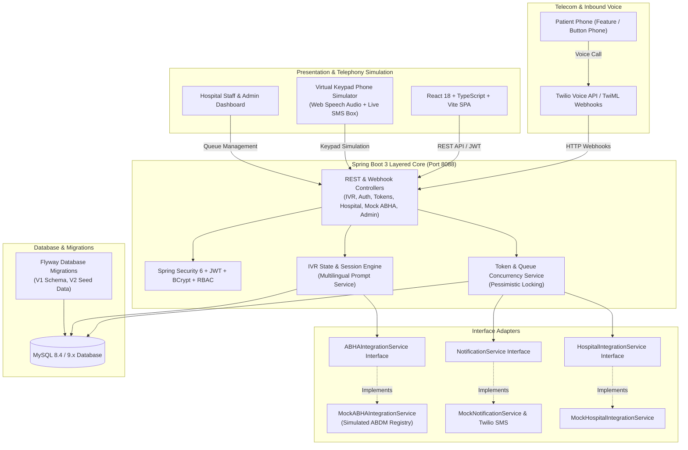
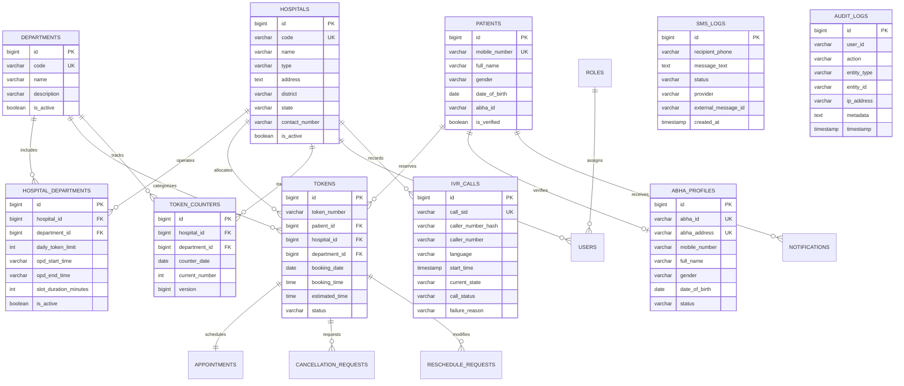
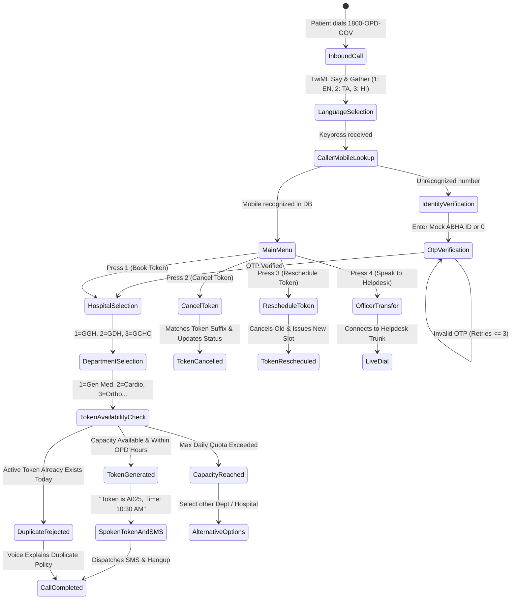

# IVR-Based Token Booking System Integrated with ABHA for Government Hospitals

> **Final-Year Engineering Project Prototype**  
> **Domain:** Healthcare Systems Engineering, Interactive Voice Response (Telephony), and Health Informatics (ABDM / ABHA)  
> **Stack:** Java 21, Spring Boot 3.3.4, Spring Security, MySQL, React 18, TypeScript, Vite, Tailwind CSS, Twilio Voice (TwiML), Docker Compose.

---

## 1. Executive Summary & Objective

In India's **Ayushman Bharat Digital Mission (ABDM)**, the *Scan & Share* OPD registration initiative allows patients to scan hospital QR codes to receive OPD queue tokens digitally. While highly successful in metro facilities, extensive field evaluations reveal a major digital inclusion gap:

1. **Feature Phone Dominance:** Over 350 million citizens in rural and semi-urban India use non-smartphone basic keypad ("button") phones.
2. **Digital Literacy & Vision Barriers:** Elderly patients and citizens with low digital literacy struggle with smartphone apps, camera focusing, and QR scanner permissions.
3. **Connectivity Deficits:** QR scanning requires active mobile data connectivity at or near hospital registration counters.
4. **Physical Proximity:** Token acquisition is often locked until the patient is physically within a 3-kilometer radius of the hospital OPD premises.

### Proposed Solution

This project presents an **Interactive Voice Response (IVR)** based OPD Token Booking System that enables any citizen with **any basic phone** (even a ₹1,000 feature phone without internet or camera) to book government hospital OPD tokens through a standard phone call.

```
Citizen Phone Call ──> IVR Toll-Free Hotline (1800-OPD-GOV)
                   ──> Select Language (English / Tamil / Hindi)
                   ──> Verify Identity (Mobile Lookup or Mock ABHA + OTP)
                   ──> Select Hospital & Clinical Department
                   ──> Concurrency-Safe Token Generated (e.g. A025)
                   ──> Voice Informs Token & Consultation Time
                   ──> Automated SMS Receipt Dispatched
                   ──> Integrated OPD Counter Queue for Hospital Staff
```

> [!IMPORTANT]
> **ACADEMIC PROTOTYPE NOTICE & ARCHITECTURAL LIMITATION**  
> This software is an **academic engineering prototype**. It **DOES NOT** claim unauthorized live production connectivity to the National Health Authority (NHA) ABDM gateways.  
> All ABHA ID lookups, OTP verifications, Hospital HMIS schedules, and SMS transmissions utilize **pluggable Mock Adapters (`MockABHAIntegrationService`, `MockHospitalIntegrationService`, `MockNotificationService`)**.  
> The system is architected using **Interface-Driven Design (Hexagonal / Clean Architecture)**, allowing verified government production APIs to be plugged in seamlessly when security authorization is granted.

---

## 2. Enterprise System Architecture



---

## 3. Database Entity Relationship (ER) Diagram



---

## 4. Patient IVR Voice Flow & State Engine



---

## 5. Token Generation & Concurrency Safety Rules

1. **Token Numbering Format:** `[DeptPrefix][001-999]` (e.g. `A001`, `A025`, `B001`).
2. **Pessimistic Concurrency Locking:** To guarantee zero duplicate token numbers even during surge call hours, `TokenCounter` row acquisition uses JPA `@Lock(LockModeType.PESSIMISTIC_WRITE)` (`SELECT ... FOR UPDATE`) in an isolated transaction.
3. **Duplicate Token Prevention:** A patient cannot hold more than one active token (`BOOKED`, `CONFIRMED`, `CALLED`) for the same hospital on the same calendar day. Any subsequent call is politely rejected via voice.
4. **OPD Time Window Guard:** Token bookings for today are strictly restricted between `08:00` and `16:00` (configurable via `system_settings`).
5. **Estimated Consultation Time Algorithm:**  
   $$\text{Estimated Time} = \text{OPD Start Time} + (\text{Token Order} - 1) \times \text{Slot Duration}$$  
   *Example:* Start 08:00 AM, Token #11 with 15-minute slot = **10:30 AM**.

---

## 6. Pre-Configured Seed Data & Test Accounts

| Role | Username | Password | Assigned Scope | Description |
| :--- | :--- | :--- | :--- | :--- |
| **Super Admin** | `superadmin` | `superadmin123` | All Facilities | System Director & Full Governance |
| **Hospital Admin** | `admin_ggh` | `admin123` | Govt General Hospital | Medical Superintendent & Quotas |
| **Hospital Staff** | `staff_ggh` | `staff123` | OPD Counter (GGH) | OPD Receptionist & Token Calling Desk |
| **Sample Patient** | `patient_test` | `patient123` | Mobile: `9876543210` | Mock ABHA: `1234-5678-9012` |

### Pre-Configured Hospitals
1. **Government General Hospital (GGH01)** — Tertiary Care Facility, Chennai (Quota: 50/dept).
2. **Government District Hospital (GDH02)** — District Headquarters, Kanchipuram (Quota: 40/dept).
3. **Government Community Health Centre (GCHC03)** — Community Center, Sriperumbudur (Quota: 30/dept).

### Pre-Configured Clinical Departments
1. General Medicine (Key 1)
2. Cardiology (Key 2)
3. Orthopaedics (Key 3)
4. Dermatology (Key 4)
5. ENT (Key 5)
6. Paediatrics (Key 6)

---

## 7. Step-by-Step Demonstration Scenarios

### Scenario 1: First-Time Caller (Tamil Flow + Mock OTP + Token Generation)
1. Navigate to **IVR Phone Simulator** (`/ivr-simulator`).
2. Set Caller Phone to `9999000111` (unregistered citizen).
3. Click **Call IVR**.
4. Hear/read welcome prompt. Press **2** on the virtual dialpad for **Tamil**.
5. Voice prompts: *"தயவுசெய்து உங்கள் 14 இலக்க ஆபா எண்ணை உள்ளிட்டு ஹாஷ் அழுத்தவும்..."*
6. Press **0** (no ABHA / new caller).
7. System generates mock OTP (`123456`) and prompts: *"சரிபார்ப்புக் குறியீடு உங்கள் அலைபேசிக்கு அனுப்பப்பட்டது..."*
8. Enter `123456` on keypad.
9. Verification succeeds! Press **1** for Government General Hospital.
10. Press **1** for General Medicine.
11. Hear voice confirm: *"உங்கள் டோக்கன் எண் A001. உத்தேச நேரம் 08:00 AM..."*
12. Inspect the **Live SMS Inbox** on the right side of the screen; the SMS confirmation arrives immediately!

### Scenario 2: Duplicate Booking Rejection
1. Immediately dial the IVR again from `9999000111`.
2. Select language -> Press **1** to book token.
3. System detects an active token already exists for today:
   *"You already have an active OPD token A001 booked for today. You cannot book another token for the same day."*
4. Call terminates safely without corrupting hospital queues.

### Scenario 3: Token Cancellation Flow
1. Patient calls from `9999000111`.
2. Press **2** from main menu (Cancel Token).
3. System cancels token `A001`, marks status `CANCELLED`, logs audit trail, and sends cancellation SMS.

### Scenario 4: Hospital Staff Queue Management
1. Login as `staff_ggh` / `staff123` at `/login`.
2. Go to **OPD Token Queue** (`/tokens`).
3. Click **Call** next to token `A001`. The audio synthesizer announces: *"Token number A001, please proceed to room"* with animated visual badge.
4. Click **Complete** once the patient finishes consultation. Status updates to `COMPLETED`.

---

## 8. Limitations & Future Real-World Challenges

> *“The major challenge is not creating the IVR menu. The major challenge is securely integrating the IVR system with different hospital systems while maintaining real-time token synchronization, identity verification, security, scalability, and operational reliability.”*

### Detailed Real-World Integration Challenges

1. **Heterogeneous Hospital HMIS Systems:** Government hospitals across Indian states utilize disparate HMIS backends (e-Sushrut, NIC e-Hospital, MedLEAP, or proprietary state software). Production IVR requires standard FHIR/HL7 adapters.
2. **Real-Time Token Synchronization:** Physical walk-ins at the hospital registration counter must synchronize instantly with telephone bookings to avoid duplicate case-sheet numbers.
3. **Patient Identity Verification Over Voice:** Unlike smartphone biometric or face authentication, IVR is restricted to DTMF digits and Aadhaar OTP over voice, requiring robust fraud prevention against brute force attacks.
4. **Shared Family Mobile Numbers:** In rural areas, one phone number is frequently shared by 4–6 family members. Production ABHA integration must support sub-profiles under a parent phone number.
5. **No-Show Rates:** Remote telephone bookings can suffer from higher no-show percentages. Automated reminder voice calls and SMS confirmation deadlines are necessary to recycle unutilized tokens.
6. **Multilingual Speech & Dialect Variations:** Beyond English, Tamil, and Hindi, regional dialects require fine-tuned Automated Speech Recognition (ASR) models for hands-free spoken input.
7. **Telecom Infrastructure & Peak Hour Concurrency:** Thousands of patients calling simultaneously between 08:00 AM and 09:00 AM requires elastic SIP trunking, telephony auto-scaling, and Redis-backed session stores.
8. **SMS Delivery Rates:** SMS delivery over DND-registered numbers requires transactional TRAI DLT registration templates.

---

## 9. Quickstart: Running Locally

### Prerequisites
- Java 21 (Temurin / OpenJDK 21 LTS)
- Maven 3.9+
- MySQL 8.0+ (running locally on port 3306)
- Node.js 18+ & npm

### Backend Setup
```bash
# 1. Create MySQL Database
mysql -u root -e "CREATE DATABASE IF NOT EXISTS hospital_ivr_db CHARACTER SET utf8mb4 COLLATE utf8mb4_unicode_ci;"

# 2. Run Backend
cd backend
export JAVA_HOME=$(/usr/libexec/java_home -v 21) # On macOS
mvn clean test                                  # Executes 14 unit & integration tests
mvn spring-boot:run                             # Starts backend on http://localhost:8088
```

### Frontend Setup
```bash
cd frontend
npm install
npm run dev                                     # Starts Vite React dev server on http://localhost:5173
```

### Docker Compose Multi-Platform Setup (Zero Prerequisites)

Anyone on your team can run the entire platform with zero manual installation of Java, Maven, MySQL, or Node.js:

```bash
# On macOS / Linux:
./docker-run.sh

# On Windows:
docker-run.bat
# (or run: docker compose up --build -d)
```
- **Web Portal:** `http://localhost:3000` (or `http://localhost:5173`)
- **REST API / Swagger UI:** `http://localhost:8088/swagger-ui.html`
- **OpenAPI Specification JSON:** `http://localhost:8088/v3/api-docs`
- **Stop Containers:** `docker compose down`

---

## 10. Swagger / OpenAPI Documentation

The Spring Boot backend exposes interactive OpenAPI 3.0 documentation:
- **Swagger UI:** [http://localhost:8088/swagger-ui.html](http://localhost:8088/swagger-ui.html)
- **JSON Specification:** [http://localhost:8088/v3/api-docs](http://localhost:8088/v3/api-docs)

---

## 11. Final Deliverables Summary

| Deliverable | Location | Description |
| :--- | :--- | :--- |
| **Project Report (DOCX)** | `PROJECT_DOCUMENTATION_REPORT.docx` | Academic project report with all 7 high-res screenshots embedded |
| **Project Documentation** | `PROJECT_DOCUMENTATION.md` | Complete markdown report with visual screenshots and viva guide |
| **Spring Boot Backend** | `backend/` | Complete Java 21, Spring Boot 3.3.4 enterprise backend |
| **React Frontend** | `frontend/` | React 18, TypeScript, Vite, Tailwind CSS portal |
| **Flyway Schema & Seed** | `backend/src/main/resources/db/migration/` | V1 Schema (19 tables) + V2 Seed Data |
| **IVR Phone Simulator** | `frontend/src/pages/IvrSimulatorPage.tsx` | Real-time virtual button phone with voice synthesis |
| **Unit & Integration Tests** | `backend/src/test/` | 14 JUnit 5, Mockito & MockMvc tests (100% passing) |
| **Docker Compose** | `docker-compose.yml` | Multi-container orchestration (MySQL + Backend + Frontend) |
| **One-Click Runners** | `docker-run.sh` / `docker-run.bat` | Cross-platform runners for macOS, Linux, and Windows |
| **Postman API Collection** | `postman_collection.json` | 20+ documented requests with auth chaining |
| **Environment Template** | `.env.example` | Production & local environment configuration variables |

